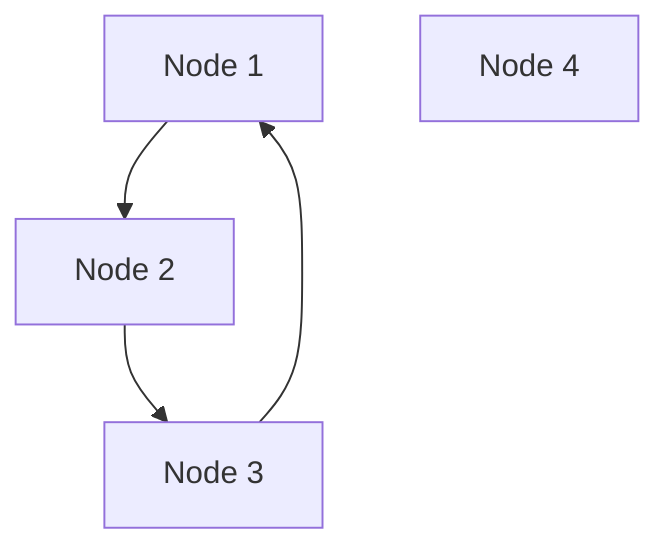

### Задание 1

**Эксперимент A**
**Прогноз:**
До операции переменные `a` и `b` ссылаются на один целочисленный объект со значением 10 и одинаковым идентификатором `id`. После выполнения `a += 1` значение переменной `a` станет равным 11 и её идентификатор изменится, а значение переменной `b` останется равным 10 и сохранит прежний `id`
**Фактический результат:**
```
a  b
10 10
140710208267672 140710208267672
11 10
140710208267704 140710208267672
```

Значение с именем b не изменилось, потому что `a` является `int` (не изменяемый тип) и при операции `+=` создается новый объект со значением `11`, а имя `b` остается ссылаться на предыдущий объект

**Эксперимент B**
**Прогноз:**
Обе переменные будут ссылаться на один и тот же список в памяти. `append` изменит объект на месте и список изменится как для `first` так и для `second`. После переназначения `second` свяжется с новым независимым объектом. При сравнении через `is` результат будет `False`, а при сравнении через `==` результат будет `True`
**Результат:**
```
first    second
[10, 20] [10, 20]
1951613302336 1951613302336
[10, 20, 30] [10, 20, 30]
1951613302336 1951613302336
[10, 20, 30] [10, 20, 30]
1951613302336 1951617121024
True False
```

До переназначения
```
Переменные            Объект в памяти
[ first ] -> [ list: [10, 20, 30] ] (id_list1) <- [ second ]
```
После переназначения
```
Переменные            Объекты в памяти
[ first  ] -----> [ list: [10, 20, 30] ] (id_list1)

[ second ] -----> [ list: [10, 20, 30] ] (id_list2)
```

**Ответы на вопросы**
1. Не меняет. Новое имя `second` начинает ссылаться на тот же объект в памяти, что и `first`
2. Неизменяемые объекты не могут быть модифицированы на месте после выделения памяти под них. При вычислении нового значения выделяется память и имя переменной перенаправляется на новое значение.
3. С помощью оператора `is`

### Задание 2
**Прогноз:**
alias будет ссылаться на тот же объект что и original
shallow создаст новый список, но вложенные списки останутся общими с original
deep создаст полностью новый список с новыми не зависимыми вложенными списками
**Результат:**
Айди original и alias одинаковые, но айди original и shallow и deep разные
Айди вложенных списков original, alias, shallow одинаковые, но у deep отличаются от original

| Операция            | Новый внешний объект | Новые вложенные объекты | Изменения независимы |
| :------------------ | :------------------: | :---------------------: | :------------------: |
| Присваивание        |         Нет          |           Нет           |         Нет          |
| Поверхностная копия |          Да          |           Нет           |       Частично       |
| Глубокая копия      |          Да          |           Да            |          Да          |

```
[[0] * 3] * 3
```
При таком умножении внешнего списка копируется три ссылки на один и тот же внутренний список. Поэтому при взаимодействии с любым из внутренних списков поменяются все
```
[[0] * 3 for _ in range(3)]
```
В случае генератора списков создаются независимые списки, у которых отличаются айди

**Ответы на вопросы**
1. Поверхностная копия копирует только внешний контейнер, сохраняет ссылки на те же вложенные дочерние объекты, глубокая копия обходит всю структуру и создает независимые копии
2. Высокий расход памяти, не все объекты поддерживают глубокое копирование. Риск дублирования объектов, которые должны оставаться общими разделяемыми ресурсами
3. Когда коллекция плоская или все элементы в коллекции относятся к неизменяемым типам

### Задание 3
**Прогноз:**
`data = [1, 2, 3]`
Количество ссылок будет 2, одна от data и одна временная от `getrefcount`
`alias = data`
Количество увеличится на 1 - 3
`container = [data]`
Количество увеличится еще на 1 - 4
`del alias`
Количество уменьшится на 1 - 3
`container.clear()`
Количество уменьшится еще на 1 - 2
**Результат:**
```
После создания: 2
После создания alias: 3
После помещения в контейнер: 4
После del alias: 3
После очистки контейнера: 2
```

**Ответы на вопросы**
1. Функция принимает объект в качестве аргумента, В момент передачи объекта создается еще одна временная локальная ссылка внутри функции. Счетчик увеличивается на 1
2. Связывание нового имени, помещение объекта в коллекцию, передача объекта в качестве аргумента в функцию
3. Удаление имени, перезапись переменной, удаление элемента из контейнера, завершение области видимости функции
4. Оператор `del` удаляет связывание имени из пространства имен. Объект удалится в случае если счетчик ссылок становится равным нулю.

**Вывод после эксперимента со слабыми ссылками:**
```
weak_recond = <__main__.Record object at 0x00000203B41078C0>
удаление сильной ссылки
weak_record = None
```
Слабая ссылка не увеличивает количество ссылок объекта. Как только удаляется единственная сильная ссылка, счетчик ссылок становится равным 0 и объект уничтожается.
Предотвращение циклических ссылок, кэширование ресурсоемких объектов

**Ответы на вопросы**
1. Объект освобождается когда его счетчик ссылок становится равным нулю
2. Не всегда. В системе память освобождается в случае когда освобождается вся арена целиком. для небольших объектов (до 512 байт) освободившийся блок возвращается во внутренний пул для повторного использования для объектов того же размера
3. Сильная ссылка увеличивает счетчик ссылок объекта и гарантирует что объект не будет удален сборщиком мусора, пока ссылка существует. Слабая ссылка позволяет обращаться к объекту, но не увеличивает счетчик ссылок объекта и не защищает объект от уничтожения сборщиком мусора

### Задание 4
**Прогноз:**
Списки first и second взаимно ссылаются друг на друга. Это образует циклическую ссылку
После удаления first и second их счетчик ссылок не будет равен 0 и они будут очищены сборщиком мусора
**Результат:**
```
first ссылается на second: True
second ссылается на first: True
Сборщик мусора включен: True
Пороги поколений (thresholds): (2000, 10, 10)
Текущая статистика поколений (count): (257, 4, 0)
first = 2652583016000 second = 2652582899776
Число ссылок очищенных сборщиком мусора 2
```


**Ответы на вопросы:**
1. Они возникают когда изменяемые объекты ссылаются друг на друга
2. Если объекты ссылаются друг на друга, а внешние переменные удалены, то к ним невозможно обратиться из кода
3. Это снижает нагрузку на процессор

### Задание 5
**Фактический вывод:**
Размер в байтах
Размер пустого списка: 56
Размер списка из десяти целых чисел: 136
Размер кортежа из десяти целых чисел: 128
Размер строки из десяти символов 51
Размер целого числа: 28
Размер объекта None: 16

Функция `getsizeof()` учитывает память под заголовок контейнера и массив ссылок на элементы, не считая их содержимое. Объекты хранятся в куче отдельно и их размер не прибавляется к размеру списка

Нет, размер изменяется скачкообразно
Список резервирует место с запасом для оптимизации скорости работы программы и чтобы избежать лишних аллокаций памяти
Длина списка отличается от объема выделенной памяти тем, что длина представляет из себя количество элементов в списке, а объем выделенной памяти показывает сколько ссылок на элементы может хранить список.

`list(range(100000))` - содержит в себе 100000 элементов. В памяти сохраняется 100000 целых чисел
`range(100000)` - объект, который хранит только 3 числовых атрибута (start, stop, step) фиксированного размера, а конкретные значения вычисляются в момент итерации

**Итоговый анализ:**
	1. Заменить генераторы списков на генераторные выражения (Эксперимент задания 5 часть 3)
	2. Использовать кортежи вместо списков для статических данных (Эксперимент задания 5 часть 3)
	3. Не использовать глубокое копирование без необходимости (Эксперимент задания 2)

**Итоговый  вывод о наиболее опасных ошибках**
1. Присваивание `a = b` для изменяемых структур копирует только ссылку, а не весь объект
2. Вложенные списки нужно создавать через генераторы списков, а не через умножение, потому что копируется ссылка на один и тот же объект
	1. Поверхностное копирование, если нужно изменять вложенные списки, потому что вложенные списки остаются общими