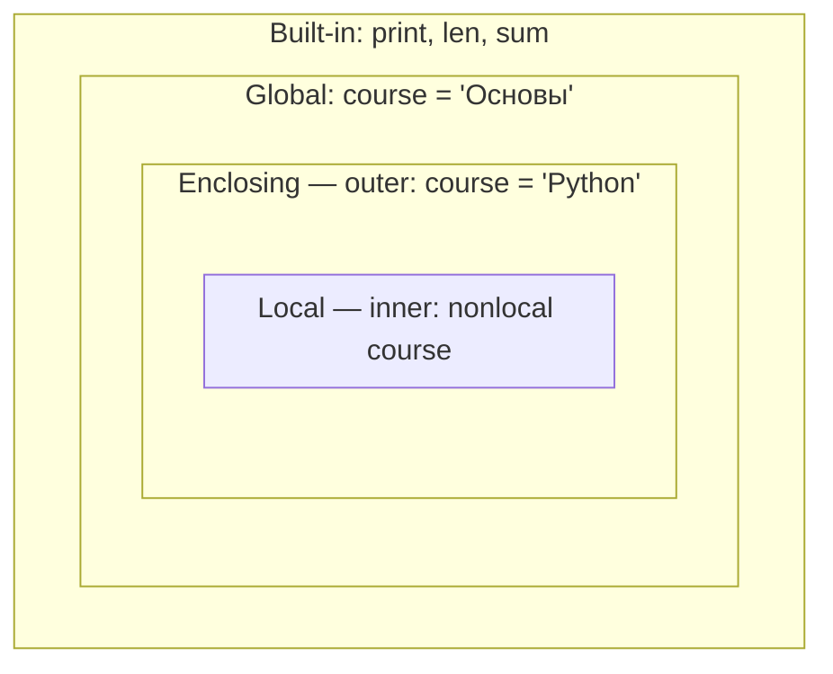

### Задание 1

|  №  | Балл  | Тип  | Пропуски  | Ожидаемый результат                  | Фактический результат             |
| :-: | :-------------: | :---------------: | :-------------------: | :----------------------------------- | :-------------------------------- |
|  1  |        0        |      project      |           2           | Недостаточный                        | Недостаточный                     |
|  2  |       59        |       exam        |           0           | Недостаточный                        | Недостаточный                     |
|  3  |       60        |     practice      |           5           | Недостаточный (снижение с Удовл.)    | Недостаточный                     |
|  4  |       74        |      project      |           1           | Удовлетворительный                   | Удовлетворительный                |
|  5  |       75        |       exam        |           4           | Удовлетворительный (снижение с Хор.) | Удовлетворительный                |
|  6  |       89        |     practice      |           2           | Хороший                              | Хороший                           |
|  7  |       90        |      project      |           1           | Отличный                             | Отличный                          |
|  8  |       100       |       exam        |           0           | Отличный                             | Отличный                          |
|  9  |       95        |     practice      |           4           | Хороший (снижение с Отл.)            | Хороший                           |
| 10  |    -5 / 105     |       exam        |           0           | Ошибка диапазона                     | Недопустимый диапазон результатов |
  Порядок проверки условий:
  Сначала проверяются диапазоны `0 <= result <= 100` и `0 <= absenses <= 5`, при неверном вводе программа завершается. После проверки диапазонов определяется уровень студента и корректируется по пропускам.
  Все ветви достижимы, недостижимых ветвей нет.
### Задание 2
| Длина списка (`n`) | Искомое число (`target`) | Линейный поиск (`Linear`) | Бинарный поиск (`Binary`) | Сортировка выбором (`Selection sort`) |
| :----------------: | :----------------------: | :-----------------------: | :-----------------------: | :-----------------------------------: |
|         10         |            6             |             7             |             4             |                  45                   |
|        100         |            42            |            43             |            10             |                 4950                  |
|        1000        |           587            |            588            |            18             |                499500                 |

|               Алгоритм                | Временная сложность | Доп. память |           От чего зависит число операций           |
| :-----------------------------------: | :-----------------: | :---------: | :------------------------------------------------: |
|  Сумма, min, max, четные, > среднего  |       `O(n)`        |   `O(1)`    |        От количества элементов в списке `n`        |
|   Линейный поиск (`linear_search`)    |       `O(n)`        |   `O(1)`    |  От длины списка `n` и позиции искомого элемента   |
|   Проверка на простоту (`is_prime`)   |    `O(sqrt(n))`     |   `O(1)`    |         От величины проверяемого числа `n`         |
| Сортировка выбором (`selection_sort`) |      `O(n^2)`       |   `O(1)`    | От длины списка `n` (всегда `n*(n-1)/2` сравнений) |
|   Бинарный поиск (`binary_search`)    |     `O(log n)`      |   `O(1)`    |        От длины отсортированного списка `n`        |
Корректность ограничения делителей корнем от n:
Делители идут парами `a * b = n`, если бы оба множителя были больше чем `sqrt(n)`, то их произведения стали бы больше чем `n`, значит хотя бы 1 из пары должен быть меньше или равен `sqrt(n)`, если до корня делителей нет, то дальше их искать нет смысла, число простое.

Псевдокод сортировки выбором:
```
АЛГОРИТМ selection_sort(A):
    ВХОД: список элементов A длины n
    ВЫХОД: отсортированный список A (in-place), количество сравнений count

    count = 0
    ДЛЯ i ОТ 0 ДО n - 2:
        min_idx = i
        ДЛЯ j ОТ i + 1 ДО n - 1:
            ЕСЛИ A[j] < A[min_idx]:
                min_idx = j
            count = count + 1
        
        ОБМЕНЯТЬ A[i] И A[min_idx]
        
    ВЕРНУТЬ count
```
Псевдокод бинарного поиска:
```
АЛГОРИТМ binary_search(A, target):
    ВХОД: отсортированный список A длины n, искомый элемент target
    ВЫХОД: количество выполненных сравнений count

    left = 0
    right = n - 1
    count = 0

    ПОКА left <= right:
        mid = (left + right) // 2
        
        count = count + 1
        ЕСЛИ A[mid] == target:
            ВЕРНУТЬ count
            
        count = count + 1
        ЕСЛИ A[mid] < target:
            left = mid + 1
        ИНАЧЕ:
            right = mid - 1

    ВЕРНУТЬ count
```
### Задание 3
1. Множество реализовано на основе хеш таблицы, поэтому она автоматически исключает дубликаты при добавлении.
2. Кортеж является неизменяемым типом. Если все его объекты неизменяемы то его можно хешировать, хеш не меняется со временем.
3. Список изменяем, при изменении содержимого изменился бы и хеш.
4. Чтобы найти элемент в списке надо его перебирать за O(n) по времени, а словарь вычисляет хеш кортежа и обращается к значению напрямую за O(1)

| Коллекция         | Где используется в `task_3.py`                          | Добавление элемента |     Поиск элемента / по ключу      |
| :---------------- | :------------------------------------------------------ | :-----------------: | :--------------------------------: |
| Список (`list`)   | `submissions`, списки попыток внутри `students_try`     |  `O(1)` (`append`)  |               `O(n)`               |
| Множество (`set`) | `all_students`, `all_labs`, `lab1`, `lab2`              |   `O(1)` (`add`)    |           `O(1)` (`in`)            |
| Словарь (`dict`)  | `students_try`, `labs_try`, `count_try`                 |       `O(1)`        |       `O(1)` (`in` / `get`)        |
| Кортеж (`tuple`)  | Записи в `submissions`, составной ключ `(student, lab)` |    Неизменяемый     | `O(n)` (при поиске внутри кортежа) |

### Задание 4

| Область видимости | Обозначение | Имена в этой области (`task_4.py`) | Что происходит при выполнении |
| :--- | :-: | :--- | :--- |
| Локальная | `L` (Local) | Функция `inner()`: `nonlocal course` | Имя `course` связывается с переменной из области `E` и меняет её на `"Advanced (Enclosing изменен)"` |
| Объемлющая | `E` (Enclosing) | Функция `outer()`: `course`, `inner` | Изначально `course = "Python (Enclosing)"`, перезаписывается вызовом `inner()` |
| Глобальная | `G` (Global) | Модуль `task_4.py`: `course`, `outer`, `arithmetic_mean` и др. | `course = "Основы (Global)"` — остается неизменной |
| Встроенная | `B` (Built-in) | `print`, `sum`, `len`, `set`, `tuple` | Имена находятся здесь, так как не переопределены в `L`, `E` и `G` |



Ошибка изменяемого значения по умолчанию
Значение `results=[ ]` создается 1 раз при определении функции в атрибуте `__defaults__`. При повторных вызовах функции этот список продолжает накапливать значения.
Fix:
Заменить `results=[ ]` на `results=None`, а новый список `results=[ ]` создается внутри функции при каждом вызове.

Замыкание:
Когда функция `make_threshold_checker(threshold)` создаёт внутри себя функцию проверки, значение `threshold` не удаляется из памяти, а «запоминается» внутри созданной функции (в атрибуте `__closure__`). Каждая новая функция помнит свой порог даже после того как внешняя функция закончила работу.
### Задание 5

| Функция             | Вход                      | Выход                  | Особый случай                              |
| :------------------ | :------------------------ | :--------------------- | :----------------------------------------- |
| `mean`              | Список чисел              | `float` (среднее)      | Пустой список -> `0.0`                     |
| `minimum`           | Список чисел              | `int` или `None`       | Пустой список -> `None`                    |
| `maximum`           | Список чисел              | `int` или `None`       | Пустой список -> `None`                    |
| `classify`          | Число или `None`          | `str` (категория)      | При `None` -> `"Нет данных"`               |
| `student_summary`   | Имя и список оценок       | `dict` (сводка)        | Пустой список -> метрики `None`            |
| `find_top_students` | Словарь студентов         | `list` (имена лидеров) | Пустые списки пропускаются                 |
| `group_summary`     | Словарь студентов         | `dict` (общая сводка)  | Пустой словарь -> `count: 0`               |
| `format_report`     | Сводки студентов и группы | `str` (текст отчета)   | Нет оценок -> `"-"`, нет лидера -> `"нет"` |
Декомпозиция и сложность:
Вычисления разделены на независимые функции. Построение сводки требует O(n) для подсчета суммы/статистики и O(K log K) для сортировки рейтинга. Итоговая сложность - O(n + K log K)

| № | Сценарий | Студентов | Лидер (`top`) | Общий ср. балл |
| :-: | :--- | :-: | :--- | :-: |
| 1 | Обычный набор | 4 | Дарья | 79.38 |
| 2 | Один студент | 1 | Ольга | 87.50 |
| 3 | Несколько лидеров | 3 | Алексей, Мария | 83.33 |
| 4 | Пустая группа | 0 | нет | 0.00 |
| 5 | Студент без оценок | 2 | Анна | 80.00 |
| 6 | Граничные значения | 4 | 90 | 71.00 |

### Вывод
Декомпозиция задачи на небольшие чистые функции позволила изолировать логику обработки данных от их отображения. Упростила тестирование условий, исключила дублирование кода.